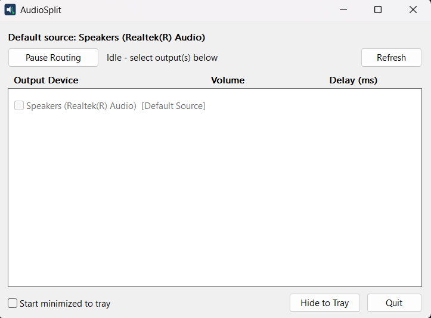

# AudioSplit

<p align="center">
  <b>Dil / Language:</b>
  <a href="#-azərbaycan-dili">🇦🇿 Azərbaycan dili</a> •
  <a href="#-english">🇬🇧 English</a>
</p>

<p align="center">
  
</p>

---

## 🇦🇿 Azərbaycan dili

Windows 10 və Windows 11 üçün virtual audio kabel tələb etməyən, quraşdırmasız, çox kiçik və portativ multi-output səs yönləndiricisi.

Kompüterin cari default səs çıxış cihazındakı səsi **WASAPI loopback** vasitəsilə tutur və eyni anda seçdiyiniz bir neçə çıxış cihazına (dinamik, qulaqlıq, HDMI/DisplayPort monitor, Bluetooth və s.) paralel göndərir.

### Əsas Xüsusiyyətlər

- **Virtual audio kabel yoxdur:** Birbaşa Windows Core Audio (WASAPI loopback + event-driven render) istifadə edir.
- **Tək portativ `.exe`:** Quraşdırma, administrator hüququ, əlavə DLL və ya Visual C++ Redistributable tələb etmir.
- **Səs döngüsü (feedback) qoruması:** Tutulan default çıxış cihazı interfeysdə deaktiv edilir (`[Default Source]`) və səs mühərrikində çıxış siyahısından sərt şəkildə kənarlaşdırılır.
- **Hər cihaz üçün müstəqil tənzimləmə:**
  - Aç/bağla (`Checkbox`)
  - Səs səviyyəsi (`0–100%`)
  - Gecikmə (`0–1000 ms`) — fərqli cihazları (xüsusən Bluetooth və HDMI) sinxronlaşdırmaq üçün
- **Saat sürüşməsi (clock drift) kompensasiyası:** Fərqli səs kartlarının saat fərqini avtomatik balanslaşdıran adaptiv gecikmə buferi.
- **Sistem tray ikonu və portativ konfiqurasiya:** Pəncərəni bağladıqda tray-a yığılır; seçimlər `.exe` faylının yanındakı `audiosplit.json` faylında saxlanılır.
- **Avtomatik cihaz yeniləməsi (`IMMNotificationClient`):** Cihaz qoşulub-ayrılanda və ya Windows default cihazı dəyişəndə proqram çökmədən siyahını və axınları yeniləyir.

### Necə İşlədilir

1. GitHub [**Releases**](https://github.com/Rrocherr/AudioSplit/releases) bölməsindən ən son `AudioSplit.exe` faylını yükləyin.
2. İstədiyiniz qovluğa qoyun və birbaşa işə salın — quraşdırma lazım deyil.
3. Siyahıdan səs göndərmək istədiyiniz əlavə cihazları işarələyin, səs səviyyəsini və gecikməni (`ms`) tənzimləyin.
4. Pəncərəni bağlasanız (`X`) və ya `Hide to Tray` düyməsini sıxsanız, proqram sistem tray-da arxa planda işləməyə davam edəcək. Tam çıxış üçün `Quit` düyməsini və ya tray sağ-klik menyusundan `Quit` seçin.

### Bluetooth Cihazlar Üçün Sinxronizasiya Məsləhəti

Bluetooth qulaqlıq və dinamiklərdə adətən 100–250 ms təbii gecikmə olur. Rəqəmsal olaraq "mənfi gecikmə" tətbiq etmək mümkün olmadığı üçün:
1. **Ən yavaş cihazı** (məsələn, Bluetooth qulaqlığı və ya dinamiki) Windows-da **Default** səs çıxış cihazı təyin edin.
2. **AudioSplit** siyahısında daha sürətli olan simli dinamik və ya HDMI monitorun qarşısında **100–250 ms** arası gecikmə dəyəri seçin.

Beləliklə, simli/HDMI çıxış Bluetooth qədər gözləyəcək və bütün cihazlar eyni anda sinxron eşidiləcək.

### Fayl Ölçüsü və Texniki Detallar

- **Real ölçülən binary ölçüsü** (`opt-level = "z"`, `lto = true`, `strip = true`): **427,520 bayt (417.5 KB / 0.408 MB)** — 15 MB hədəfindən ~36 dəfə kiçikdir.
- Rust və rəsmi `windows` crate-i ilə nativ Win32 UI + WASAPI üzərində qurulub; yalnız Windows 10/11-in standart sistem DLL-lərindən istifadə edir (xarici runtime DLL asılılığı yoxdur).
- GitHub Actions release pipeline-ı `x86_64-pc-windows-msvc` hədəfində statik CRT (`+crt-static`) ilə build edib `AudioSplit.exe` və `SHA256SUMS.txt` fayllarını Releases bölməsinə yükləyir.

### Antivirus və SmartScreen Xəbərdarlığı Barədə

`AudioSplit.exe` rəqəmsal imza (Code Signing sertifikatı) olmayan, kiçik ölçülü nativ Win32 icra faylıdır. Bu səbəbdən Windows Defender SmartScreen və ya bəzi antivirus proqramları onu səhvən **yalan xəbərdarlıq (false positive)** kimi işarələyə bilər.

- Bütün mənbə kodu açıqdır və yoxlanıla bilər.
- Releases bölməsindəki fayllar birbaşa bu repodakı GitHub Actions workflow-u ilə təmiz mühitdə qurulur və `SHA256SUMS.txt` ilə verifikasiya oluna bilər.
- İstəsəniz aşağıdakı təlimatla öz kompüterinizdə birbaşa mənbə kodundan build edə bilərsiniz.

### Məlum Məhdudiyyətlər

- Yalnız **Windows 10 / Windows 11 (x64)** əməliyyat sistemləri dəstəklənir.
- **WASAPI Exclusive Mode** ilə işləyən proqramlar Windows audio mikserindən yan keçdiyi üçün loopback ilə tutula bilmir.
- Bəzi audio drayverlərdə Windows-un Default çıxış cihazının səsini `0%` etmək və ya Mute qoymaq loopback səsini də kəsə bilər.
- Gecikmə (`0–1000 ms`) yalnız əlavə çıxış cihazlarına tətbiq olunur; default cihazdan daha yavaş olan cihazı sürətləndirmək (mənfi gecikmə) fiziki olaraq mümkün deyil.

### Mənbədən Build Etmək

Tələb: [Rust](https://rustup.rs/) (`x86_64-pc-windows-msvc` və ya `x86_64-pc-windows-gnu`).

```powershell
cargo test
cargo build --release
```

Hazır icra faylı: `target/release/AudioSplit.exe`

---

## 🇬🇧 English

A tiny, portable, zero-install multi-output audio router for **Windows 10 and Windows 11** that requires no virtual audio cable.

**AudioSplit** captures system audio from the current default playback device via **WASAPI loopback** and routes it in parallel to multiple selected audio output devices simultaneously (speakers, headphones, HDMI/DisplayPort monitors, Bluetooth devices, etc.).

### Key Features

- **No Virtual Audio Cable Required:** Built directly on Windows Core Audio (WASAPI loopback capture + event-driven shared-mode render).
- **Single Portable `.exe`:** No installer, no administrator privileges, no external DLLs, and no Visual C++ Redistributable required.
- **Feedback Loop Protection:** The captured default output device is disabled in the UI (`[Default Source]`) and strictly excluded by the audio engine so it can never be routed back into itself.
- **Per-Device Controls:**
  - Enable / Disable checkbox
  - Independent volume slider (`0–100%`)
  - Adjustable delay (`0–1000 ms`) to synchronize devices with different latencies (especially Bluetooth and HDMI outputs)
- **Adaptive Clock-Drift Compensation:** Per-device delay ring buffer with smooth fractional resampling to compensate for hardware clock drift between different sound cards/DACs.
- **System Tray & Portable Config:** Minimizes to the Windows system tray on close; all settings are stored in a lightweight `audiosplit.json` file right next to `AudioSplit.exe`.
- **Automatic Hot-Plug Handling (`IMMNotificationClient`):** Seamlessly refreshes the device list and re-syncs active streams without crashing when devices are plugged/unplugged or when the default Windows playback device changes.

### How to Use

1. Download the latest `AudioSplit.exe` from [**GitHub Releases**](https://github.com/Rrocherr/AudioSplit/releases).
2. Place it in any folder and run it directly — no installation required.
3. Check the additional output devices you want to mirror audio to, and adjust each device's volume (`%`) and delay (`ms`).
4. Closing the window (`X`) or clicking `Hide to Tray` keeps AudioSplit running in the system tray. Use the `Quit` button or right-click the tray icon and choose `Quit` to exit completely.

### Bluetooth Synchronization Tip

Bluetooth headphones and speakers typically introduce 100–250 ms of hardware latency. Since negative delay is physically impossible:
1. Set your **slowest device** (e.g., Bluetooth speaker/headphones) as the Windows **Default** output device.
2. In **AudioSplit**, enable your faster wired speakers or HDMI monitor and add **100–250 ms** of delay to match the Bluetooth latency.

This delays the faster wired outputs so all devices play in exact sync.

### Binary Size & Technical Details

- **Measured release binary size** (`opt-level = "z"`, `lto = true`, `strip = true`): **427,520 bytes (417.5 KB / 0.408 MB)** — well below the 15 MB target.
- Written in pure Rust using Microsoft's official `windows` crate (native Win32 Common Controls v6 GUI + WASAPI); links only against built-in Windows 10/11 OS system DLLs.
- The GitHub Actions release workflow builds with `x86_64-pc-windows-msvc` and static CRT linking (`+crt-static`), uploading `AudioSplit.exe` and `SHA256SUMS.txt` automatically on version tags (`v*`).

### Antivirus & SmartScreen False Positives

Because `AudioSplit.exe` is a compact, unsigned native Win32 executable (no paid Code Signing certificate), Windows Defender SmartScreen or some antivirus engines may occasionally flag it as an unrecognized or heuristic **false positive**.

- The project is 100% open source and auditable.
- Official release binaries are built automatically on GitHub Actions runners directly from this repository and include `SHA256SUMS.txt` checksums.
- You can also easily compile the executable yourself from source using the commands below.

### Known Limitations

- Supports **Windows 10 and Windows 11 (x64)** only.
- Applications using **WASAPI Exclusive Mode** bypass the Windows audio mixer and cannot be captured via WASAPI loopback.
- On some audio drivers, muting or setting the Windows default device's master volume to `0%` also silences the loopback stream.
- Delay (`0–1000 ms`) can only be added to mirrored output devices; a device with higher latency than the default source cannot be shifted earlier in time (set the highest-latency device as the Windows default instead).

### Building from Source

Prerequisite: [Rust](https://rustup.rs/) (`x86_64-pc-windows-msvc` or `x86_64-pc-windows-gnu`).

```powershell
cargo test
cargo build --release
```

Output binary: `target/release/AudioSplit.exe`

To trigger an automated GitHub Release build via GitHub Actions:

```bash
git tag v1.0.0
git push origin v1.0.0
```

## License / Lisenziya

[MIT License](LICENSE)
